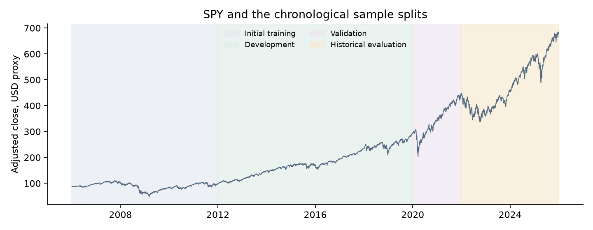
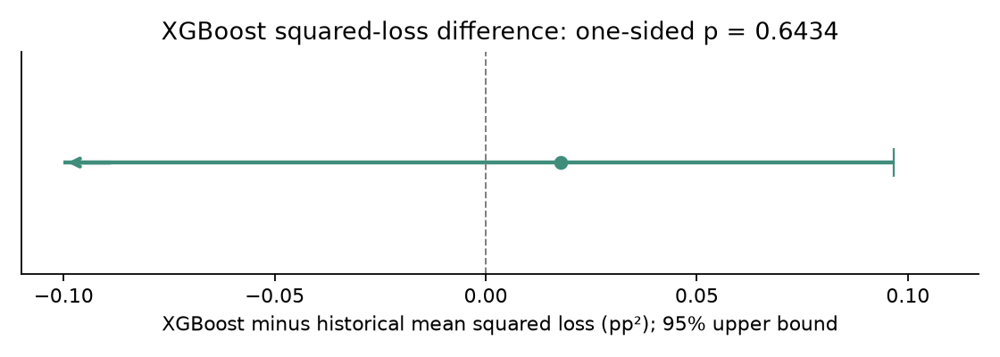
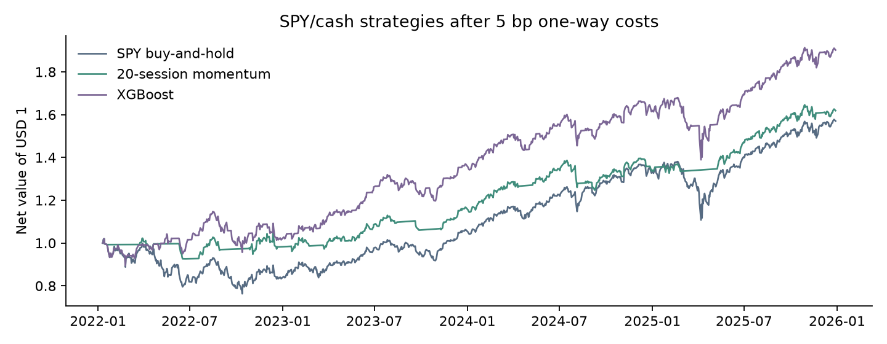
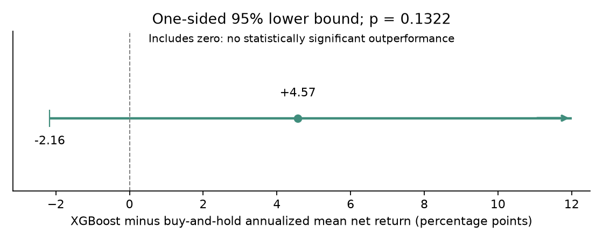

# SPY Return Prediction and Trading with XGBoost

Can historical market indicators predict SPY's next five-session return and improve trading performance?

This study uses XGBoost with eight features derived from SPY, QQQ and TLT to forecast SPY returns and implement a simple SPY/cash trading strategy.

During 2022–2025, the XGBoost strategy achieved a **17.68% annualized net return**, compared with **12.10% for SPY buy-and-hold**. However, its forecasting and trading advantages were not statistically significant at the 5% level.

## Data and prediction timing

Daily market data cover 2006–2025, using three ETFs:

| ETF | Description | Purpose |
| --- | --- | --- |
| SPY | S&P 500 ETF | Asset being predicted and traded |
| QQQ | Nasdaq-100 ETF | Captures technology-heavy equity-market movements |
| TLT | Long-term US Treasury ETF | Captures interest-rate and bond-market movements |

There are **15,093 daily ETF-price observations** across the three funds.

At the close of trading session $t$, the model predicts SPY's return over the next five sessions:

$$Y_t=100\log\left(\frac{O^{adj}_{t+6}}{O^{adj}_{t+1}}\right).$$

The adjusted opening price is:

$$O_t^{adj}=O_t\frac{C_t^{adj}}{C_t}.$$

Trading takes place at the next opening, $t+1$, and the five-session holding period ends at the opening of $t+6$.

## Eight predictive features

The model uses six indicators describing SPY's own historical movements and two additional indicators from QQQ and TLT.

| Feature | Description |
| --- | --- |
| `SPY_r1` | Latest daily SPY log return |
| `SPY_r2` | SPY log return lagged one session |
| `SPY_r3` | SPY log return lagged two sessions |
| `SPY_mom5` | Cumulative SPY log return over five sessions |
| `SPY_mom20` | Cumulative SPY log return over twenty sessions |
| `SPY_vol20` | Twenty-session sample standard deviation of SPY returns |
| `QQQ_r1` | Latest daily QQQ log return |
| `TLT_r1` | Latest daily TLT log return |

QQQ provides information about Nasdaq-100 performance, particularly growth and technology-oriented equities. TLT provides information about long-duration US Treasury bonds, which respond to interest-rate movements and changing investor risk preferences.

These two ETFs complement SPY's historical indicators with information from different parts of the financial market.

All eight predictors are available at the forecast origin. No feature-selection algorithm is used.

## XGBoost model and cross-validation

XGBoost is trained to minimize squared prediction error.

The model uses 100 trees, maximum depth 1, learning rate 0.03, minimum child weight 100, and L2 regularization of 10. The complete fixed settings are saved in [model_spec.json](model_spec.json).

### Expanding-window cross-validation

Model development follows a chronological expanding-window procedure: the training sample grows over time, while validation always takes place in later years.

| Fold | Training period | Validation period |
| --- | --- | --- |
| 1 | 2006–2011 | 2012–2014 |
| 2 | 2006–2014 | 2015–2017 |
| 3 | 2006–2017 | 2018–2019 |

A separate validation stage covers 2020–2021, followed by the final historical evaluation during 2022–2025.

The procedure works as follows:

1. Construct the eight predictors using historical information available by each forecast date.
2. Sample training observations every fifth trading session to avoid overlapping five-session training targets.
3. Fit XGBoost using only the training observations available in each fold.
4. Predict the subsequent validation period and evaluate forecasting error.
5. Exclude training observations whose target outcomes extend into the validation period.
6. Fit the final model using eligible pre-2022 observations and evaluate it on 2022–2025 data.

The test period is not used to fit the forecasting model. The notebook evaluates the documented fixed configuration; it does not claim an external hyperparameter search.

Training uses nonoverlapping five-session targets. Daily evaluation forecasts are generated for consecutive eligible sessions, so their five-session outcomes can overlap.



## Forecasting results

Forecasting performance is evaluated over **997 observations in 2022–2025**, against a historical-mean benchmark. The benchmark is the mean of eligible training targets, held fixed within each evaluation stage; its training window expands between stages.

| Model | RMSE | MAE | Out-of-sample R² |
| --- | ---: | ---: | ---: |
| Historical mean | 2.368 | 1.754 | 0.0000 |
| XGBoost | 2.372 | 1.762 | −0.0032 |

Prediction errors are measured in percentage points of five-session log return.

XGBoost's squared-error forecasting accuracy is slightly worse than that of the historical mean.



A one-sided forecasting comparison using Bartlett Newey–West standard errors with **20 daily-session lags** gives **p = 0.6434**. The difference is not statistically significant at the 5% level. The loss difference is XGBoost squared error minus historical-mean squared error; the test asks whether its expectation is below zero.

## Trading strategy

The XGBoost forecasts determine whether the portfolio holds SPY or cash:

$$w_t=\begin{cases}1,&\hat Y_t>0,\\0,&\hat Y_t\leq0.\end{cases}$$

A positive forecast means invest fully in SPY. Otherwise, hold cash.

The strategy reconsiders its position every five trading sessions, executes at the following opening, applies 5 basis points per one-way position change, and earns a lagged three-month Treasury-rate proxy when holding cash. No leverage or short-selling is used.

Two benchmarks are included: SPY buy-and-hold and a simple 20-session momentum strategy.

### Trading results, 2022–2025

| Strategy | Annualized net return | Sharpe ratio above cash | Maximum drawdown |
| --- | ---: | ---: | ---: |
| SPY buy-and-hold | 12.10% | 0.484 | −25.19% |
| 20-session momentum | 12.97% | 0.762 | −10.05% |
| XGBoost | 17.68% | 0.806 | −17.28% |



XGBoost achieves the highest simulated annualized return and Sharpe ratio among the three strategies.

### Statistical significance

The estimated annualized mean daily net-return advantage of XGBoost over SPY buy-and-hold is **4.57 percentage points**, with a Newey–West standard error of **4.09 percentage points**.

The one-sided p-value is **0.1322**.



Since p is greater than 0.05, the trading advantage is not statistically significant. The arithmetic mean-return advantage is distinct from the difference in compounded annualized returns.

Both forecasting and trading inference are retrospective and exploratory: hypotheses and testing choices were selected after historical outcomes were available. They are separate comparisons, using Bartlett HAC20 and one-sided 95% bounds.

## Conclusion

The eight-feature XGBoost model connects financial-market indicators, return prediction, and systematic SPY trading.

Although it does not outperform the historical mean in forecasting accuracy, its trading strategy achieves higher simulated returns and a higher Sharpe ratio than SPY buy-and-hold during 2022–2025.

Forecasting error and trading performance measure different aspects of a predictive model. The observed trading advantage is not statistically significant, and historical performance does not guarantee future results. Revised vendor prices, assumed execution and cash rates, overlapping targets and few independent market regimes limit the conclusions.

## Reproducibility

The repository contains the complete research implementation and supporting files:

- [research.ipynb](research.ipynb) — Executed XGBoost research notebook.
- [methods.py](methods.py) — Feature construction, forecasting evaluation and trading calculations.
- [model_spec.json](model_spec.json) — Model configuration.
- [data/](data/) — SPY, QQQ, TLT and cash-rate input data, with provenance and hashes.
- [results/](results/) — Forecasts, statistical comparisons and trading results.
- [figures/](figures/) — Research visualizations.
- [tests/](tests/) — Verification tests.

Install the dependencies:

```bash
pip install -r requirements.txt
```

Run the notebook:

```bash
python run_notebook.py
```

Run the verification tests with `python -m pytest tests -q`.
The notebook fits the fixed model for each chronological stage, verifies exact agreement with the saved forecasts, and reproduces the reported evaluation and trading calculations.
